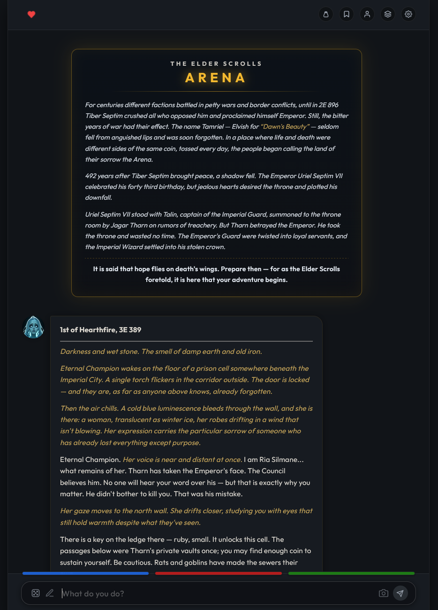

# LM-ARENA: THE ELDER SCROLLS TEXT ADVENTURE

An interactive, LLM-driven roleplaying text adventure recreating **The Elder Scrolls: Chapter I — Arena** (3E 389, The Imperial Simulacrum).

Embark across Tamriel to reconstruct the shattered **Staff of Chaos**, rescue Emperor Uriel Septim VII, and defeat the usurper Battlemage Jagar Tharn.

---

<p align="center">
  
</p>

---

## FEATURES

### D20 Roleplay & Combat
* **Attribute Checks**: Classic attributes (Strength, Intelligence, Willpower, Agility, Speed, Endurance, Personality, Luck) determine modifiers for all trials.
* **Vitals & Exertion**: Track Health, Magicka, and Stamina in real time. Reckless maneuvers draw upon your physical reserves.
* **Fluid Prose**: Numerical dice rolls, checks, and inventory logs stay inside collapsible tool cards, keeping narrative prose immersive.

### The Realm of Tamriel
* **Nine Provinces**: Journey through Cyrodiil, Skyrim, Morrowind, High Rock, Hammerfell, Summerset Isle, Valenwood, Elsweyr, and Black Marsh.
* **The Main Quest**: Delve into all eight legendary dungeons—from Fang Lair to the Crypt of Hearts—before storming the Imperial Palace.
* **Tamrielic Calendar**: Authentic dates, hours, and seasonal progression across the Empire.

### Character & Arsenal
* **Classic Heritages & Classes**: All original heritages and 18 classic classes across Warrior, Mage, and Thief disciplines.
* **Backpack & Spells**: Manage weapons, armor, enchanted trinkets, and custom spells crafted in the Mages Guild.
* **Companions**: Guided by the spectral visions of Ria Silmane and sellswords met across Tamriel's taverns.

---

## GETTING STARTED

### Quick Start
Double-click `run_local.bat` (or `./run_local.ps1` in PowerShell, `./run_local.sh` on Linux/macOS).

### Models
Place model files in the `models/` directory:
* **Chat LLM (GGUF)**: `models/llm/` (e.g. `Equinox-31B.i1-Q4_K_M.gguf`)
* **Art Checkpoints (SDXL / SD 1.5)**: `models/checkpoints/`
* **LoRAs**: `models/loras/`

### Manual Setup
1. Create and activate a virtual environment:
   ```bash
   python -m venv .venv
   .venv\Scripts\activate   # Windows
   source .venv/bin/activate # Linux/macOS
   ```
2. Install dependencies:
   ```bash
   pip install -r requirements.txt
   ```
3. Launch:
   ```bash
   python desktop.py
   # Or browser mode: python app.py -> http://localhost:5000
   ```
